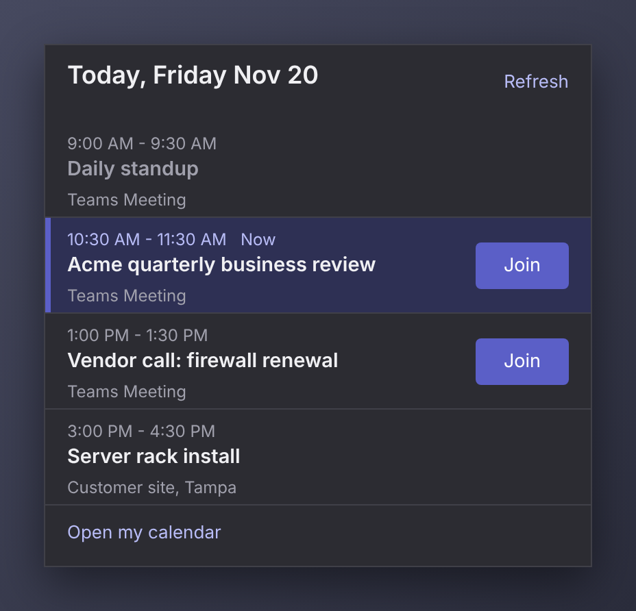
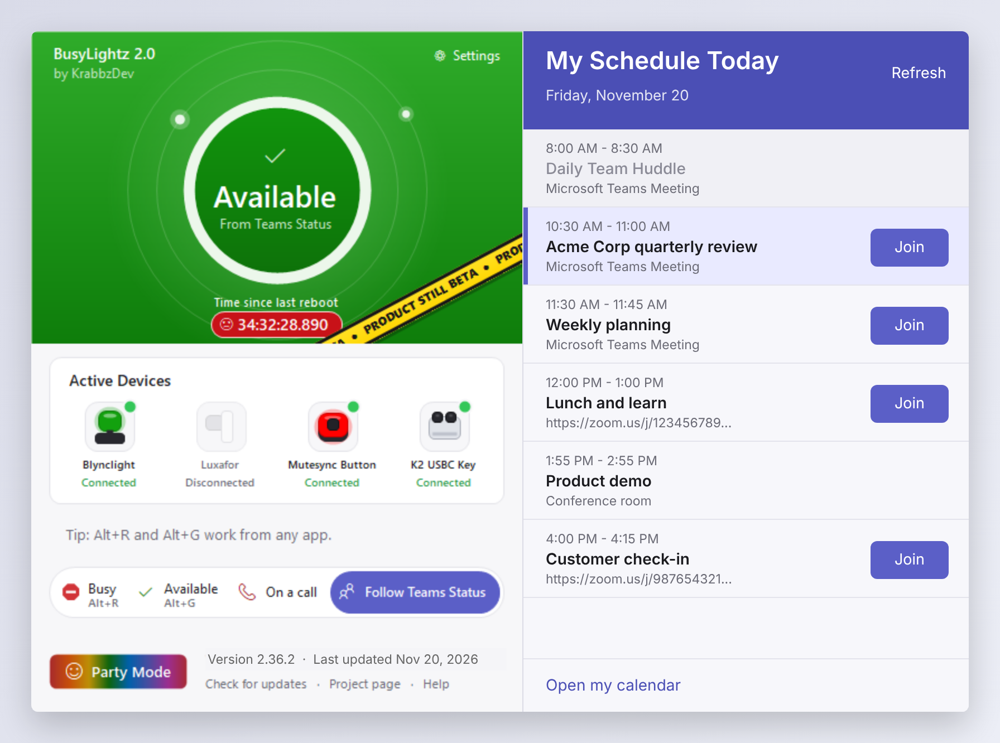
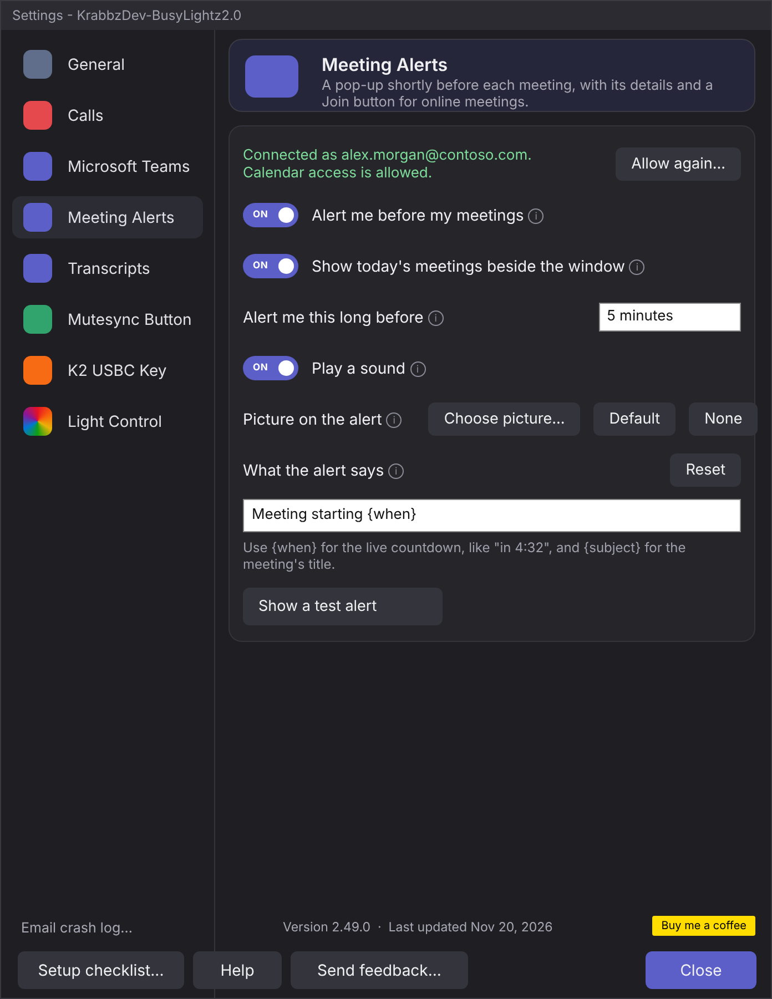

# Meeting Alerts

A small pop-up shortly before each meeting in your Microsoft 365 calendar, so you don't miss one while you're heads down. It shows the meeting's title, time, place and organizer, and for online meetings (Teams and others) a **Join** button that opens the meeting.

## Turn it on (once)

1. **Connect to Microsoft Teams** first (tray menu, or Settings > Microsoft Teams).
2. Open **Settings > Meeting Alerts** and click **Allow access...**. Microsoft asks in your browser whether BusyLightz may read your calendar. Click **Accept**.
3. That's it. The page says *Calendar access is allowed*, and alerts start about a minute later.

Meeting Alerts is **on by default**, but does nothing until you allow calendar access. When BusyLightz updates to a version that has it, it shows a notice, *New: Meeting Alerts*. If you still haven't allowed calendar access, it reminds you with *Meeting Alerts needs your calendar*, at most once a week. Click either to open this page in Settings. The reminders stop once you allow access, or if you turn **Alert me before my meetings** off.

**Is it safe?** BusyLightz asks for Microsoft's read-only `Calendars.Read` permission, for your own calendar only. It reads the time, title, place, organizer and join link of upcoming meetings, uses them for the alert, and keeps none of it. It can't change, accept, decline or delete anything. You can take the permission back any time at [myapps.microsoft.com](https://myapps.microsoft.com).

If your organization's IT blocks users from allowing apps themselves, the button says so, and an admin needs to add `Calendars.Read` to the BusyLightz app registration (see [Setting Up Teams for Your Organization](Setting-Up-Teams-for-Your-Organization.md)).

## Today's meetings

Click the BusyLightz icon in the system tray (near the clock) and choose **Today's meetings**, and a small window shows today's calendar.

- A band at the top shows the product's name, *BusyLightz 2.0*, and *Click here or double-click the tray icon to open the program*. Click it to open the BusyLightz window.
- A header shows the date, the day as a **timeline** with a marker for *now*, and how much of the day is **booked** and **free**.
- The meeting on **right now** is a highlighted card marked *Happening now*, with a bar for how far through it you are and how long is left. Finished meetings are small and dimmed, with a check.
- The ones still to come are cards with their **time**, **title**, how long until they start and their place (*Teams*, *Zoom* and so on, or what the calendar says). All-day events come first.
- Where there's 15 minutes or more between meetings, a dashed line shows how long you're **free**.
- Online meetings that haven't finished have a **Join** button.
- The round button in the header (or **Refresh**) reads the calendar again, and **Open my calendar** opens Outlook on the web.
- It closes when you click anywhere else, or press **Esc**.
- A normal click on the tray icon opens the tray menu, the same as a right-click. **Double-click** opens the BusyLightz window.

It uses the same calendar access as the alerts, so if you haven't allowed that yet, the window says so and has a button to the Settings page.

## My Schedule Today, beside the window

When you open the BusyLightz window, a **My Schedule Today** panel sits against its right side, the same height, with today's meetings in the same look as the window above: the timeline header, the meeting on now highlighted, finished ones dimmed, free time between meetings, and a **Join** button on online meetings that haven't finished. It has its own title bar and bottom bar, like the BusyLightz window, with an outline all round. The **×** in its title bar hides it and turns off **Show today's meetings beside the window**, so it stays away until you switch that back on in Settings > Meeting Alerts. It moves with the window, goes when you close or minimize it, and reads the calendar again every minute while it's showing. If the right side of the screen is too close, it goes on the left instead.

Turn it off with **Show today's meetings beside the window** in Settings > Meeting Alerts. If you haven't allowed calendar access yet, the panel says so, with a button to the right Settings page.

## What the alert shows

- An **icon** at the left: a video camera for online meetings, a calendar for the rest.
- A first line with a **live timer** that ticks every second, like a stopwatch: *Meeting starting in 4:32*. It turns **red** for the last minute. If the alert only appears after the meeting has started, it counts up instead: *Meeting started 0:42 ago*.
- The meeting's **title**, its **start and end time**, and its **place** and **organizer** (when it has them).
- **Join** (online meetings only): opens the meeting link in your browser, which hands it to Teams.
- **Snooze 2 min**: shows the alert again in two minutes.
- **Dismiss**: closes it.

The pop-up sits in the bottom right corner of the screen, above other windows, and **doesn't take over the keyboard**, so it won't swallow what you're typing. If several meetings are close together, the alerts stack up. An alert closes by itself when the meeting starts. (If it only appears at or after the start, it stays for 30 seconds so there's time to click **Join**.)

Declined and cancelled meetings and all-day events are skipped. Meetings that already started more than 5 minutes ago aren't alerted about (say, when you've only just started BusyLightz).

## Settings

All on the **Meeting Alerts** page of Settings:

| Setting | What it does |
| --- | --- |
| **Alert me before my meetings** | The on/off switch. |
| **Show today's meetings beside the window** | On by default. Untick it to hide the panel beside the BusyLightz window. |
| **Alert me this long before** | 1, 2, 5 (default), 10 or 15 minutes before the meeting starts. |
| **Play a sound** | A short sound with the alert. On by default. It stays quiet while you're on a call. |
| **Picture on the alert** | A picture where the video camera icon would be, with a small video camera on its corner for online meetings. BusyLightz comes with one. **Choose picture...** uses your own instead (squared off from the middle, so keep the subject centered; a small copy stays on this PC and your original isn't touched), **Default** goes back to the one that comes with BusyLightz, and **None** shows just the icon. |
| **What the alert says** | The alert's first line. Type your own: `{when}` becomes the live countdown, like *in 4:32* (or *now*) and `{subject}` becomes the meeting's title. The default is `Meeting starting {when}`. **Reset** puts the default back. |
| **Show a test alert** | Shows an example alert, so you can check the wording, sound and place on screen. |

Meeting Alerts keeps working when **Sync with Microsoft Teams** is off, because it reads your calendar and doesn't touch your Teams status. Turning the **Alert me before my meetings** switch off stops it.

## Transcripts of your Teams meetings

The same page can also save a copy of the transcript Teams makes of your Teams meetings, if you turn it on. See [Teams Meeting Transcripts](Meeting-Transcripts.md).

## If it doesn't work

- **No alerts at all:** is Settings > Meeting Alerts saying *Calendar access is allowed*? If not, click **Allow access...**. Is **Alert me before my meetings** on? Does your meeting have a start time today, and isn't it declined or all-day?
- **It says Microsoft didn't allow reading your calendar:** click **Allow again...** and accept in the browser. If that fails, your organization's admin may need to approve `Calendars.Read`.
- **Alerts show after the meeting started:** BusyLightz checks the calendar once a minute, so an alert can be up to a minute late. Pick a longer lead time.

---
[Guide home](README.md) · [Installing and Updating](Installing-and-Updating.md) · [Using the Light](Using-the-Light.md) · [Mutesync Button and K2 USBC Key](Mute-Button-and-K2-Key.md) · [Teams Status](Teams-Status.md) · [Meeting Alerts](Meeting-Alerts.md) · [Teams Meeting Transcripts](Meeting-Transcripts.md) · [Call Detection](Call-Detection.md) · [Setup Checklist](Setup-Checklist.md) · [Setting Up Teams for Your Organization](Setting-Up-Teams-for-Your-Organization.md) · [Troubleshooting and FAQ](Troubleshooting-and-FAQ.md) · [For Developers](For-Developers.md)
