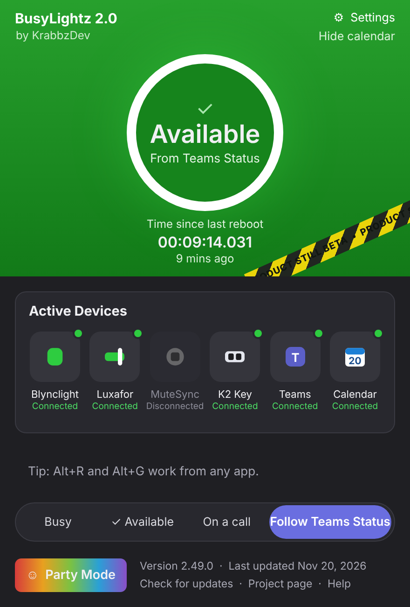
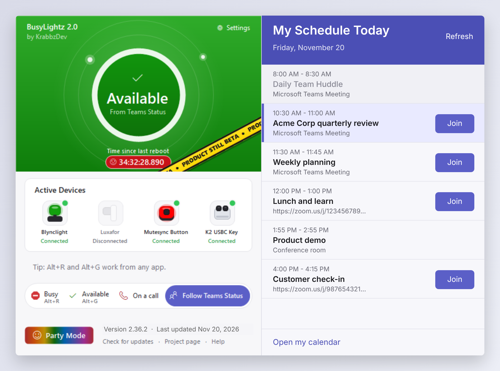

# KrabbzDev-BusyLightz2.0

**One app for your Embrava Blynclight and Luxafor Flag busy lights, together.**

A small Windows app that controls USB busy lights, so the people around you can see at a glance whether you're free, busy or on a call. Plug in any mix of **Embrava Blynclight** and **Luxafor Flag** lights, as many of each as you like, and they all show the same color at the same time. It replaces both the Embrava Connect app and Luxafor's own app.

**No busy light? That's fine.** You can still use BusyLightz without one: it sets your Microsoft Teams status to Do not disturb whenever you're on a call in any app that uses your microphone (Zoom, a phone app, a browser call and so on), then back when you hang up. Teams can't see those calls on its own, so BusyLightz tells it for you. See [Teams Status](Teams-Status.md).

> **This app is still in BETA.** If something doesn't work the way this guide describes, see [Troubleshooting and FAQ](Troubleshooting-and-FAQ.md).

## Why I made this

> My workday runs through a lot of apps. Teams for meetings, Zoom when a client sends the invite, Cytracom for the phones, Loom for quick videos, and a browser call now and then. Every one of them has its own idea of whether I'm "busy", and none of them talk to each other.
>
> What I wanted was simple: **if my mic is hot, my lights are red.** It shouldn't matter which app the call is in.
>
> Once that worked, I wanted the rest to follow. Teams should show me as busy during a Cytracom or Zoom call, not just a Teams one. And the hardware on my desk should work together instead of each needing its own app: my Blynclight and Luxafor show the same color, my Mutesync Button mutes me in every app with its ring showing whether I'm muted, and my K2 key handles the little things I do all day.
>
> No vendor apps, no juggling. One small app that knows when I'm on a call and tells everything else.
>
> — KrabbzDev

## What it does

- **Shows your status on the light:** pick **Busy** (red), **Available** (green) or **On a call** (flashing red and blue) yourself, or let the light **Follow Teams Status**. Choose from three window styles, in Light or Dark. See [Using the Light](Using-the-Light.md).
- **Goes back to Teams on its own:** whatever you pick switches back to Follow Teams Status after 15 minutes, with a countdown so you know one is on. Change the time, or turn it off, in Settings. See [Override timer](Using-the-Light.md#override-timer).
- **Flashes whenever you're on a call:** any app using your microphone (Teams, Zoom, Cytracom, a browser call and so on) makes the light flash red and blue (or steady red, if you prefer), then it goes back when you hang up. See [Call Detection](Call-Detection.md).
- **Tells Teams you're busy:** picking Busy or On a call sets your Teams status to **Do not disturb** (or Busy, if you prefer; it's a setting), and Available sets Available. During any call, in Teams, Zoom, Cytracom or another app, Teams shows you as *Do not disturb*. See [Teams Status](Teams-Status.md).
- **Sets a Teams status message:** coworkers see a message like *On a video call* (the default) or *In a meeting*, or your own, next to your name while your lights are red. Every message ends with *- responses may be delayed*. See [Status message](Teams-Status.md#status-message-while-your-lights-are-red).
- **Meeting alerts:** a pop-up shortly before each meeting in your Microsoft 365 calendar, with a live timer and a **Join** button, plus **My Schedule Today** beside the window and **Today's meetings** in the tray menu. See [Meeting Alerts](Meeting-Alerts.md).
- **Party Mode:** cycles quickly through every color, to check every light is working.
- **Light Control:** set the brightness, how fast calls flash, and the color for each status. See [Light Control](Using-the-Light.md#light-control).
- **Mutesync Button:** press it to mute or unmute your mic in every app; its ring shows red when muted and green when live. No MuteMe app needed. See [Mutesync Button and K2 USBC Key](Mute-Button-and-K2-Key.md).
- **K2 USBC Key macros:** each of its two buttons, and both together, runs an action you pick, like typing your email address, pressing a shortcut, muting your mic or switching Busy and Available. No K2 software needed.
- **Active Devices:** the window shows every light and button, lit when plugged in and greyed out when not.
- **Switches you can read at a glance:** every switch in Settings shows **ON** or **OFF**. To leave something alone, turn it off: **Control my USB lights**, **Sync with Microsoft Teams**, **Use the Mutesync button** and **Use the K2 key**.
- **Send feedback:** send an idea or report a problem from the tray menu or Settings, as an issue on GitHub.
- **Works with several lights at once:** every Blynclight and Luxafor Flag on the PC shows the same color, including ones plugged in later. Tested with the Blynclight Plus and Luxafor Flag 2.
- **Keeps itself up to date:** new versions install silently in the background, then a card lists what changed. **Check and install updates** (tray menu or Settings) installs one straight away, with no waiting and, even for PCs installed for everyone, no administrator.
- **A short tray menu:** left-click or right-click the tray icon for the same menu: Open, Today's meetings, Red/Busy, Green/Available, On A Call, Re-authenticate Microsoft 365, Settings, Check and install updates, Help, Send feedback, Exit and the version at the bottom.

## Quick start

1. **[Download the installer](https://github.com/krabbzdev/KrabbzDev-BusyLightz2.0/releases/latest/download/KrabbzDev-BusyLightz2.0.msi)** and run it. It installs just for you, with no admin rights needed. (IT can [install it for everyone on a PC](Installing-and-Updating.md#installing-for-everyone-on-a-pc-program-files) instead.)
2. The **Setup checklist** opens the first time. Follow it top to bottom:
   - Check your lights are found.
   - Click **Connect** and sign in with your work account. (Meeting alerts ask for calendar access separately, later, in Settings > Meeting Alerts.)
   - Click **Quit it** for Embrava Connect, then uninstall Embrava Connect from **Settings > Apps**.
   - *Light follows your Teams status* is already on.
3. That's it. The app starts with Windows and lives in the system tray (bottom-right, near the clock).

## Pages

| Page | What's in it |
| --- | --- |
| [Installing and Updating](Installing-and-Updating.md) | Download, install, automatic updates, uninstall, deploying to many PCs |
| [Using the Light](Using-the-Light.md) | The window, every button and menu item, override timer, hotkeys, notifications, Settings, Send feedback |
| [Mutesync Button and K2 USBC Key](Mute-Button-and-K2-Key.md) | Muting with a Mutesync Button, its ring colors, and K2 USBC Key macros |
| [Teams Status](Teams-Status.md) | Connecting to Teams, what each color means, Do not disturb in Teams, status messages |
| [Meeting Alerts](Meeting-Alerts.md) | A pop-up before each meeting with a Join button, My Schedule Today, and their settings |
| [Call Detection](Call-Detection.md) | How the light knows you're on a call, ignoring apps, Test microphone |
| [Setup Checklist](Setup-Checklist.md) | Every step of the checklist explained |
| [Setting Up Teams for Your Organization](Setting-Up-Teams-for-Your-Organization.md) | One-time steps for an IT admin |
| [Troubleshooting and FAQ](Troubleshooting-and-FAQ.md) | Common problems and questions |
| [For Developers](For-Developers.md) | Building, publishing releases, project layout |

---
[Guide home](README.md) · [Installing and Updating](Installing-and-Updating.md) · [Using the Light](Using-the-Light.md) · [Mutesync Button and K2 USBC Key](Mute-Button-and-K2-Key.md) · [Teams Status](Teams-Status.md) · [Meeting Alerts](Meeting-Alerts.md) · [Call Detection](Call-Detection.md) · [Setup Checklist](Setup-Checklist.md) · [Setting Up Teams for Your Organization](Setting-Up-Teams-for-Your-Organization.md) · [Troubleshooting and FAQ](Troubleshooting-and-FAQ.md) · [For Developers](For-Developers.md)
