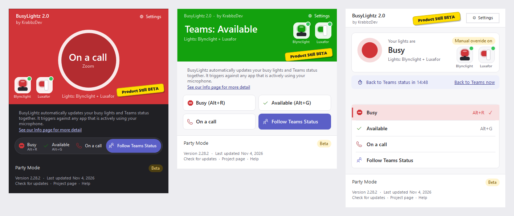
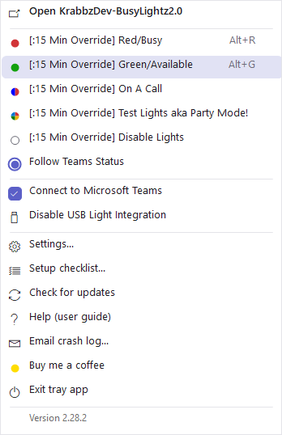
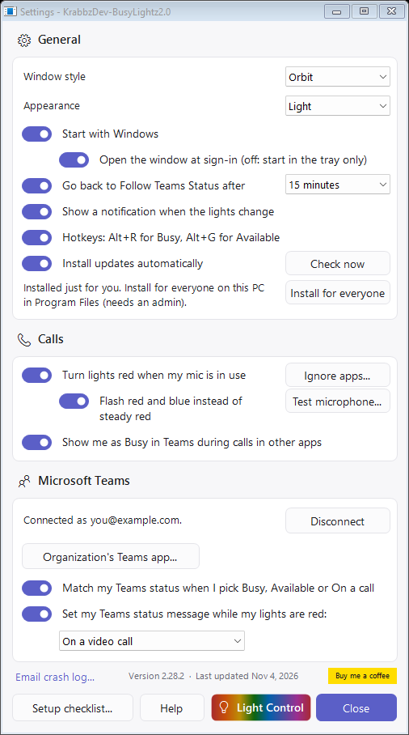
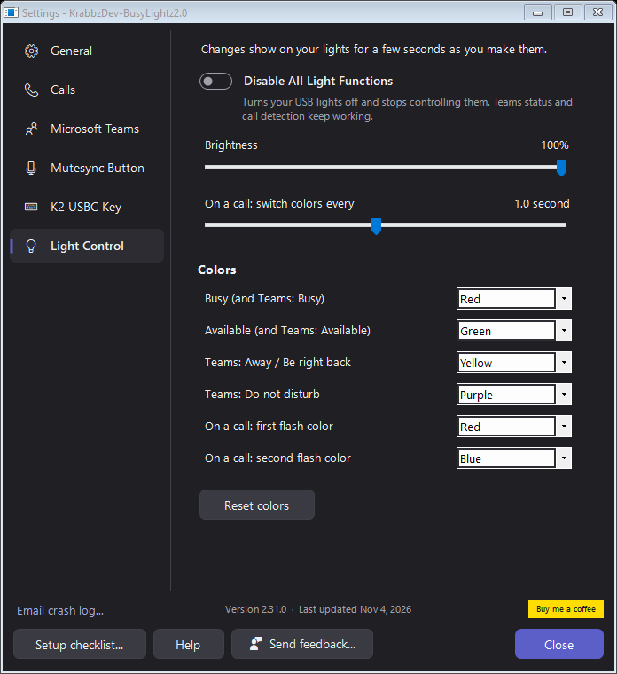

# Using the Light

You control the light from the **app window** or the **tray icon**.

## Supported lights

| Light | Notes |
| --- | --- |
| **Embrava Blynclight** (USB) | Tested with the [Blynclight Plus](https://store.embrava.com/products/blynclight-plus). Other Blynclight models that plug in by USB may work. |
| **Luxafor Flag** (USB) | Tested with the [Luxafor Flag 2](https://luxafor.com/product/flag2/). Controlled directly over USB; Luxafor's own app isn't needed. |

**Tested lights:** BusyLightz has been built and tested with the Blynclight Plus and the Luxafor Flag 2, the two lights KrabbzDev has and uses every day, side by side. Other models haven't been tested.

You can plug in **any number of each**. They all show the same color at the same time, including Party Mode, calls and Teams status. Lights plugged in later are found within a couple of seconds and set to match.

BusyLightz also works with a **Mutesync Button** and a **K2 USBC Key** macro key. See [Mutesync Button and K2 USBC Key](Mute-Button-and-K2-Key.md).

### Active Devices

The window's **Active Devices** panel has a tile for every device BusyLightz works with: **Blynclight**, **Luxafor**, **Mutesync Button** and **K2 USBC Key**. A plugged-in device is drawn lit, with a green dot and *Connected*: lights glow in their current color, and the Mutesync Button tile glows in its ring's color. A device that isn't plugged in is greyed out and says *Disconnected*. Two or more of the same light show as e.g. *2 Luxafors*.

**Use a data cable.** Some USB cables only carry power: the light may glow at plug-in but Windows can't see it, so the app can't control it.

- **Open the window:** double-click the tray icon, or use the Start menu entry.
- **Closing the window** only hides it. The app keeps running in the tray, and the light keeps working.
- **The tray icon** is a colored dot that matches the light, and flashes with it during calls. In Party Mode it cycles through the colors smoothly, once every 3 seconds, rather than as fast as the light (fast flashing over a large area can trigger seizures). A small white badge means an override is on.

## The window

Pick how the window looks under **Window style** in [Settings](#settings). Each style works in Light and Dark mode.

| Style | Looks like |
| --- | --- |
| **Orbit** (the default) | The top of the window glows in your status color, with a big ring showing the status and its icon, e.g. ✓ *Available* over *From Teams Status*. Two faint orbits circle the ring, each with a small dot that drifts slowly around it. During an override the ring is a countdown: it empties as the time left runs out. Under the ring, **Time since last reboot** is a running clock in hours, to the millisecond (e.g. *34:08:49.234*), with the same time in words underneath that updates as the minutes pass (*Just now*, *1 min ago*, *32 mins ago*, *1 hr 12 mins ago*, *1 day 3 hrs ago*); after 24 hours it turns into a red pill with a ☹. (Windows' Fast Startup keeps the clock running through a shut down; only a restart resets it.) The modes are one pill-shaped switcher below. |
| **Color block** | The top of the window fills with your status color, with the status in large text. The modes are four tiles below. |
| **Fluent list** | A status card, with the modes as a list like Windows Settings, hotkeys on the right. |

Every style has the same parts:

| Part | What it does |
| --- | --- |
| **Status** | What the lights are doing right now, e.g. *Busy*, *Teams: Available*, *On a call (Zoom)*, *Party Mode* or *Light not found*. |
| **Active Devices** | A tile for each device, lit when plugged in and greyed out when not. See [Active Devices](#active-devices). |
| **Info line** | While an override is on: how long until it goes back to Teams status, e.g. *Back to Teams status in 12:10*. Click **Back to Teams now** to go back early. Otherwise, a tip about the hotkeys. |
| **Busy (Alt+R)** (stop sign) | Sets the light red, then back to Follow Teams Status after the [override time](#override-timer). |
| **Available (Alt+G)** (check mark) | Sets the light green, then back to Follow Teams Status after the override time. |
| **On a call** (phone) | Flashes red and blue (switching once a second, unless you change it in [Light Control](#light-control)), then back to Follow Teams Status after the override time. Handy for a call the app can't detect, such as a desk phone. |
| **Follow Teams Status** (people) | The light shows your Microsoft Teams status. See [Teams Status](Teams-Status.md). |
| **Party Mode** (small rainbow button, bottom left) | Cycles quickly through every color, four times a second, then back to Follow Teams Status after the override time. Handy for checking every light is working and matched. During a party the button reads **Stop the party**, which goes back to Follow Teams Status. |
| **⚙ Settings** (top right) | Opens [Settings](#settings). |
| **Version and links** (beside Party Mode) | The version and when it was last updated, and under it **Check for updates**, **Project page** and **Help** (this guide) links. |

The mode you picked is filled in with its color. The mode you pick is remembered, even after a restart, and is put back if you unplug and replug the light.

### Override timer

Busy, Available, On a call, Party Mode and Disable Lights (in the tray menu) *override* your Teams status, so it's easy to forget one is still on. While one is on, the window shows the countdown and the tray icon gets a small white badge. After **15 minutes** the lights go back to **Follow Teams Status** on their own, and a notification says so. The countdown shows in the window and when you hover over the tray icon, and it keeps counting through restarts. Picking any mode again starts the timer over.

Change how long overrides last (5 minutes to 4 hours) in [Settings](#settings). To keep overrides on until you change them, switch off **Go back to Follow Teams Status after**.

**During a call** the light flashes red and blue automatically (or shows steady red, if you turn flashing off in Settings) and goes back to your choice afterwards. See [Call Detection](Call-Detection.md). If you pick a color *during* a call, your choice wins until that call ends. Going back to Follow Teams Status during a call (by hand, or when the override runs out) brings the call colors back.

## The tray menu (right-click the tray icon)

Each mode has a dot in its color, with a ring around the one that's on. The menu follows your Light or Dark **Appearance** setting.

| Item | What it does |
| --- | --- |
| **Open KrabbzDev-BusyLightz2.0** | Opens the window. |
| **[:15 Min Override] Red/Busy** / **Green/Available** | Same as the window's Busy and Available buttons. The time in brackets is your [override time](#override-timer) from Settings, e.g. *[1 Hr Override]*, or *[Override]* when overrides stay on until you change them. |
| **[:15 Min Override] On A Call** | Same as the window's On a call button. |
| **[:15 Min Override] Test Lights aka Party Mode!** | Same as the window's Party Mode button. |
| **[:15 Min Override] Disable Lights** | Turns the lights off, then back to Follow Teams Status after the override time. A detected call still makes them flash. |
| **Follow Teams Status** | Light follows Teams. |
| **Connect to Microsoft Teams** | Sign in so the app can read your Teams status (checked when connected; click again to disconnect). |
| **Disable USB Light Integration** | When checked, the app turns your USB lights off and stops controlling them. Teams status, call detection and the Teams status message keep working. Handy on a PC without a busy light, or when another app runs the light. Click again to turn the lights back on. Remembered after a restart. The same setting as **Disable All Light Functions** in [Light Control](#light-control). |
| **Disable Teams Integration** | When checked, the app leaves Microsoft Teams alone: it stops reading your Teams status, setting Busy during other calls and setting a status message, and puts back your own status. Your lights and call detection keep working, and your Teams sign-in is kept. Click again to turn it back on. Remembered after a restart. The same setting as **Disable Teams Integration** in [Settings > Microsoft Teams](#microsoft-teams). |
| **Settings...** | Opens [Settings](#settings). |
| **Setup checklist...** | Opens the [Setup Checklist](Setup-Checklist.md). |
| **Check for updates** | Looks for a newer version now. |
| **Help (user guide)** | Opens this guide. |
| **Send feedback...** | Opens [Send feedback](#send-feedback): an idea, a problem or a question, as an issue on the project's GitHub page. |
| **Email crash log...** | Starts an email with the app's log attached. See [If the app crashes](Troubleshooting-and-FAQ.md#if-the-app-crashes). |
| **Buy me a coffee** | Opens KrabbzDev's Buy Me a Coffee page. |
| **Exit tray app** | Closes the app. The light stays on its last color (Party Mode and flashing turn off). The app starts again at your next sign-in. |
| **Version x** (at the bottom) | The version you're running. |

The ring around a mode's dot shows the mode *you* chose, even while a call is temporarily showing the call colors.

## Hotkeys

These work from any app, as long as the tray app is running:

| Keys | Action |
| --- | --- |
| **Alt+R** | Busy (red) |
| **Alt+G** | Available (green) |

Hotkeys take that key combination away from other programs; for example, Outlook uses Alt+R for Reply. If another program already owns one of them, the app tells you when it starts and that hotkey won't work.

## Notifications

Whenever what the light shows changes, a notification appears in the bottom-right corner, for example:

- *Light set to red: On a call (Zoom).*
- *Light set to purple: Teams: Do not disturb.*
- *No light found. Plug your Blynclight or Luxafor back in.*

Party Mode's color changes don't notify. Turn notifications off in [Settings](#settings).

## Settings

Open with the **⚙ Settings** button in the window or **Settings...** in the tray menu. Settings has a list of pages on the left, each with its own colored icon: **General**, **Calls**, **Microsoft Teams**, **Mutesync Button**, **K2 USBC Key** and **Light Control**. Each page opens with a header saying what's on it. Each setting has an on/off switch in the page's color, and a small **ⓘ** beside it: hover over it, or click it, to see what the setting does. Changes take effect immediately.

### General

| Setting | What it does |
| --- | --- |
| **Window style** | **Orbit** (the default), **Color block** or **Fluent list**. See [The window](#the-window). |
| **Appearance** | **Light** (the default) or **Dark** colors for the window and Settings, title bar included. Changing either reopens the windows in the new look. |
| **Start with Windows** | Starts the app when you sign in. |
| **Open the window at sign-in** | When off, the app starts quietly in the tray. |
| **Go back to Follow Teams Status after** | The [override timer](#override-timer) for every mode you pick by hand. On by default. Pick how long overrides last on the right: 5, 10, 15 (default) or 30 minutes, or 1, 2 or 4 hours. |
| **Show a notification when the lights change** | The pop-ups described above. |
| **Hotkeys: Alt+R / Alt+G** | Turn off if they clash with another program. |
| **Install updates automatically** | When off, the app only updates when you click **Check now** / **Check for updates**. Greyed out when BusyLightz is installed for everyone on the PC: its background updater installs updates. |
| **Install for everyone** | Shown when BusyLightz is installed just for you. Installs it in `C:\Program Files\BusyLightz` for everyone on the PC (needs an admin). See [Installing and Updating](Installing-and-Updating.md#installing-for-everyone-on-a-pc-program-files). |
| **Learn more about this project here** | Opens the project's page on GitHub. |

### Calls

| Setting | What it does |
| --- | --- |
| **Turn lights red when my mic is in use** | [Call Detection](Call-Detection.md) on or off. **Ignore apps...** picks apps that shouldn't count. |
| **Flash red and blue instead of steady red** | On by default: lights flash red and blue during calls. Switch off for steady red. |
| **Test microphone...** | Shows live which apps Windows reports using the microphone, for when a call doesn't turn the lights red. See [Call Detection](Call-Detection.md#test-microphone). |
| **Show me as Busy in Teams during calls in other apps** | See [Teams Status](Teams-Status.md#busy-in-teams-during-other-calls). |

### Microsoft Teams

| Setting | What it does |
| --- | --- |
| **Disable Teams Integration** | Stops all syncing with Teams: reading your status, setting Busy during calls and the status message. The lights and call detection keep working, and your sign-in is kept. The options below are greyed out while it's on. The same setting as **Disable Teams Integration** in the tray menu. See [Teams Status](Teams-Status.md#turning-teams-off). |
| **Connect** / **Disconnect** | Shows who you're connected as. **Organization's Teams app...** is for [organization setup](Setting-Up-Teams-for-Your-Organization.md). |
| **Match my Teams status when I pick Busy, Available or On a call** | See [Teams Status](Teams-Status.md#teams-matches-what-you-pick). |
| **Set my Teams status message while my lights are red** | On by default, showing *On a video call*. Pick another message, or **Custom message...** to type your own. See [Teams Status](Teams-Status.md#status-message-while-your-lights-are-red). |

### Mutesync Button and K2 USBC Key

The mute button's on/off switch and ring colors, and what each K2 USBC Key button does. See [Mutesync Button and K2 USBC Key](Mute-Button-and-K2-Key.md).

### At the bottom of Settings

| Item | What it does |
| --- | --- |
| **Email crash log...** (left) | Starts an email with the app's log attached. See [If the app crashes](Troubleshooting-and-FAQ.md#if-the-app-crashes). |
| **Version** (middle) | The version you're running and when it was last updated, e.g. *Version 2.31.0 · Last updated Nov 4, 2026*. |
| **Buy me a coffee** (right) | Opens [KrabbzDev's Buy Me a Coffee page](https://buymeacoffee.com/krabbzdev), if you'd like to say thanks. Also in the tray menu. |
| **Setup checklist...** | Opens the [Setup Checklist](Setup-Checklist.md). |
| **Help** | Opens this guide. |
| **Send feedback...** | Opens [Send feedback](#send-feedback). |

### Light Control

The **Light Control** page in Settings. At the top, a picture of a Blynclight and a Luxafor glows in whatever color your real lights are showing. Each change is saved at once and shows on your lights (and the picture) for a few seconds, whatever they were showing: the On a call slider flashes, a color shows that status, and brightness shows the lit color. The page scrolls.

| Setting | What it does |
| --- | --- |
| **Disable All Light Functions** | Turns your USB lights off and stops controlling them, while Teams status and call detection keep working. The same setting as **Disable USB Light Integration** in the tray menu. While it's on, the other light settings are greyed out. |
| **Brightness** | A slider from 5% to 100% (the default), for every light and color. |
| **On a call: switch colors every** | A slider for how long On a call shows each of its two flash colors: a tenth of a second to 2 seconds. The default is 1 second. |
| **Colors** | The color for Busy, Available, Teams Away, Teams Do not disturb, and the two colors On a call flashes between. Click a dot to pick red, orange, yellow, green, cyan, blue, purple, pink or white; the chosen one is ringed with a check, and hovering a dot shows its name. The tray icon and window use your colors too. **Reset colors** puts the defaults back. |

## Send feedback

**Send feedback...** (in the tray menu and at the bottom of Settings) is for ideas, problems and questions. Pick **Idea**, **Problem** or **Other**, give it a title and details, and click **Continue on GitHub**. Your browser opens a new issue on the project's GitHub page, filled in, for you to submit. You'll need a free GitHub account.

GitHub issues are public. With **Add my BusyLightz version, Windows version and connected devices** on (the default), the issue also lists those technical details, to help track down problems. It never includes your logs, name, email or accounts.

## Colors at a glance

These are the default colors. Change them in [Settings > Light Control](#light-control).

| Light | Meaning |
| --- | --- |
| 🟢 Green | Open / Available |
| 🔴 Red | Busy, or on a call |
| 🟣 Purple | Teams: Do not disturb |
| 🟡 Yellow | Teams: Away / Be right back |
| ⚫ Off | Disable Lights, or Teams: Offline |
| 🔴🔵 Flashing red/blue | On a call (detected, or the On A Call button) |
| 🌈 Cycling | Party Mode |

---
[Guide home](README.md) · [Installing and Updating](Installing-and-Updating.md) · [Using the Light](Using-the-Light.md) · [Mutesync Button and K2 USBC Key](Mute-Button-and-K2-Key.md) · [Teams Status](Teams-Status.md) · [Call Detection](Call-Detection.md) · [Setup Checklist](Setup-Checklist.md) · [Setting Up Teams for Your Organization](Setting-Up-Teams-for-Your-Organization.md) · [Troubleshooting and FAQ](Troubleshooting-and-FAQ.md) · [For Developers](For-Developers.md)
